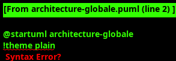
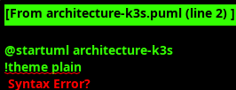
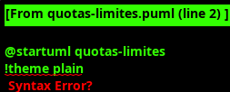
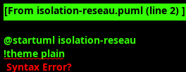
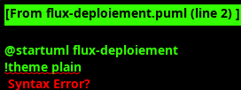
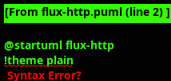

# Architecture GANDAL PaaS - Documentation complète

Ce document explique en détail l'architecture du prototype GANDAL PaaS déployé sur AWS. Chaque composant, flux de données et mécanisme d'isolation est décrit pour faciliter la compréhension et la présentation à tes camarades.

---

## Table des matières

1. [Vue d'ensemble](#1-vue-densemble)
2. [Architecture globale AWS](#2-architecture-globale-aws)
3. [Architecture K3s interne](#3-architecture-k3s-interne)
4. [Gestion des quotas et limites](#4-gestion-des-quotas-et-limites)
5. [Isolation réseau (NetworkPolicy)](#5-isolation-réseau-networkpolicy)
6. [Flux de déploiement](#6-flux-de-déploiement)
7. [Flux HTTP complet](#7-flux-http-complet)
8. [Composants détaillés](#8-composants-détaillés)

---

## 1. Vue d'ensemble

### 1.1 Objectif du prototype

GANDAL PaaS est un **Platform-as-a-Service multi-tenant** qui permet à plusieurs utilisateurs de déployer leurs applications de manière isolée sur une infrastructure partagée. Le prototype sur AWS valide la mécanique Kubernetes avant le déploiement sur XCP-ng.

### 1.2 Principes fondamentaux

**Multi-tenancy** : Chaque utilisateur a son propre namespace Kubernetes avec :
- Quotas de ressources (CPU, RAM, nombre de pods)
- Isolation réseau (les projets ne peuvent pas communiquer)
- Labels de propriété (`gandal.io/owner`, `gandal.io/project`)

**Automatisation** : Un script Python (`gandal_deploy.py`) crée automatiquement :
- Le namespace du projet
- Les configurations de sécurité (quotas, NetworkPolicies)
- Le déploiement de l'application
- L'exposition publique via Ingress

**Simplicité** : L'utilisateur fournit :
- Son nom (`alice`)
- Le nom du projet (`memoire`)
- Le nom de l'application (`my-api`)
- L'image Docker (`localhost:5000/my-api:v1`)
- Le port (`80`)

→ Le PaaS génère automatiquement l'URL : `http://my-api-memoire-alice.16.170.20.250.sslip.io`

### 1.3 Diagrammes disponibles

Tous les diagrammes PlantUML sont dans `diagrams/` :

| Fichier | Description |
|---|---|
| `architecture-globale.puml` | Vue AWS : VPC, EC2, Elastic IP, Security Groups |
| `architecture-k3s.puml` | Vue interne K3s : namespaces, composants, pods |
| `quotas-limites.puml` | Séquence de validation des quotas |
| `isolation-reseau.puml` | NetworkPolicy et flux bloqués/autorisés |
| `flux-deploiement.puml` | Séquence complète du déploiement |
| `flux-http.puml` | Séquence HTTP depuis le client jusqu'au pod |

**Pour générer les PNG** :
```bash
cd diagrams/
plantuml *.puml
```

---

## 2. Architecture globale AWS



### 2.1 Composants AWS

#### VPC (Virtual Private Cloud)
- **CIDR** : 10.0.0.0/16
- **Région** : eu-north-1 (Stockholm)
- **Rôle** : Réseau privé isolé pour l'infrastructure GANDAL

#### Sous-réseau public
- **CIDR** : 10.0.0.0/24
- **Zone** : eu-north-1a
- **Rôle** : Contient l'instance EC2 avec accès Internet

#### Internet Gateway (IGW)
- **Rôle** : Permet la communication bidirectionnelle entre le VPC et Internet
- **Attaché à** : VPC GANDAL
- **Utilisation** :
  - Trafic sortant : Pull d'images Docker depuis Docker Hub
  - Trafic entrant : Requêtes HTTP vers les applications

#### Elastic IP
- **Adresse** : 16.170.20.250
- **Type** : IPv4 publique statique
- **Rôle** : Garantit une IP fixe pour le DNS wildcard (sslip.io)
- **Coût** : 0,005 $/heure quand allouée (même instance arrêtée)

#### Security Group
Pare-feu au niveau de l'instance :

| Port | Protocol | Source | Usage |
|---|---|---|---|
| 22 | TCP | IP CloudShell | SSH pour administration |
| 80 | TCP | 0.0.0.0/0 | HTTP public (Traefik Ingress) |
| 443 | TCP | 0.0.0.0/0 | HTTPS (prévu, non utilisé) |
| 6443 | TCP | IP CloudShell | API Kubernetes (kubectl) |

**Remarque** : Le port 5000 (registry) n'est **pas ouvert** → Le registry n'est accessible que depuis l'instance (localhost).

#### Instance EC2
- **Type** : m7i-flex.large
- **vCPU** : 2
- **RAM** : 8 Go
- **Disque** : 30 Go gp3 (provisioning: 3000 IOPS)
- **OS** : Ubuntu 24.04 LTS
- **AMI** : Canonical officielle
- **Coût** : ~0,09 $/heure

### 2.2 DNS Wildcard avec sslip.io

**Problème résolu** : Comment exposer plusieurs applications sans configurer manuellement le DNS ?

**Solution** : [sslip.io](https://sslip.io) est un service DNS public qui résout automatiquement :

```
*.16.170.20.250.sslip.io → 16.170.20.250
```

**Exemples** :
- `my-api-memoire-alice.16.170.20.250.sslip.io` → 16.170.20.250
- `web-test-bob.16.170.20.250.sslip.io` → 16.170.20.250
- `anything.16.170.20.250.sslip.io` → 16.170.20.250

**Avantages** :
- ✅ Aucune configuration DNS requise
- ✅ Fonctionne instantanément
- ✅ Pas de compte à créer
- ✅ Gratuit

**Sur XCP-ng** : Remplacer par le DNS interne GANDAL + certificats wildcard.

### 2.3 Flux réseau typique

```
Utilisateur (Internet)
    ↓ DNS Query: my-api-memoire-alice.16.170.20.250.sslip.io
sslip.io → 16.170.20.250
    ↓ HTTP GET /
Elastic IP (16.170.20.250)
    ↓
Security Group (Port 80 autorisé)
    ↓
Instance EC2 eth0
    ↓
Traefik Ingress Controller (localhost:80)
    ↓ Route selon Host header
Service Kubernetes (ClusterIP 10.43.x.x)
    ↓ Load balancing
Pod nginx (IP 10.42.0.x)
```

---

## 3. Architecture K3s interne



### 3.1 Qu'est-ce que K3s ?

**K3s** est une distribution **légère de Kubernetes** conçue pour :
- IoT et edge computing
- Déploiements simples (single binary)
- Faible empreinte mémoire (~500 Mo vs 2 Go pour K8s standard)

**Différences avec Kubernetes standard** :
| Composant | Kubernetes | K3s |
|---|---|---|
| Base de données | etcd (cluster) | SQLite (embedded) |
| Stockage | Externe (CSI) | local-path provisioner |
| Ingress | À installer | Traefik inclus |
| Load Balancer | Externe | ServiceLB inclus |
| Binaire | Multiple | Single binary (~70 Mo) |

### 3.2 Control Plane (Nœud maître)

#### API Server
- **Port** : 6443 (HTTPS)
- **Rôle** : Point d'entrée pour toutes les opérations Kubernetes
- **Clients** : kubectl, gandal_deploy.py, Traefik, metrics-server
- **Authentification** : Certificats TLS (générés par K3s)

#### Scheduler
- **Rôle** : Décide sur quel nœud placer les pods
- **Critères** :
  - Ressources disponibles (CPU, RAM)
  - Contraintes (node selectors, affinity)
  - Quotas du namespace

#### Controller Manager
- **Rôle** : Boucle de réconciliation
- **Exemples de contrôleurs** :
  - ReplicaSet Controller : Maintient le nombre de réplicas
  - Deployment Controller : Gère les mises à jour
  - Service Controller : Synchronise les endpoints

#### etcd (SQLite)
- **Rôle** : Base de données distribuée (ici single-node)
- **Stockage** : Tous les objets Kubernetes (pods, services, configmaps, etc.)
- **Localisation** : `/var/lib/rancher/k3s/server/db/state.db`

### 3.3 Worker Node (même machine en K3s)

#### Kubelet
- **Rôle** : Agent sur chaque nœud
- **Responsabilités** :
  - Communiquer avec l'API Server
  - Démarrer/arrêter les conteneurs
  - Exécuter les probes (readiness, liveness)
  - Rapporter l'état des pods

#### Containerd
- **Rôle** : Runtime de conteneurs (remplace Docker)
- **Responsabilités** :
  - Pull des images depuis le registry
  - Création des conteneurs
  - Gestion du cycle de vie

#### CNI Flannel
- **Rôle** : Network overlay pour la communication inter-pods
- **Réseau pods** : 10.42.0.0/16
- **Mode** : VXLAN (encapsulation)
- **Fonctionnement** :
  - Chaque pod a une IP unique
  - Les pods peuvent communiquer directement (sauf NetworkPolicy)
  - Masquage NAT pour l'accès Internet

### 3.4 Composants système (namespace kube-system)

#### Traefik Ingress Controller
- **Version** : ~v2.11
- **Ports** : 80 (HTTP), 443 (HTTPS)
- **Rôle** : Routeur HTTP reverse-proxy
- **Configuration** : Dynamique (watch Ingress objects)
- **Features** :
  - Routing par Host header
  - Load balancing vers les Services
  - Middlewares (rate limit, auth, etc.)

#### CoreDNS
- **Port** : 53 (UDP)
- **Rôle** : Résolution DNS interne du cluster
- **Zones gérées** :
  - `cluster.local` : DNS Kubernetes
  - `svc.cluster.local` : Services uniquement
- **Exemple** :
  ```
  my-api.project-alice-memoire.svc.cluster.local → 10.43.5.10
  ```

#### metrics-server
- **Rôle** : Collecte des métriques de ressources
- **Sources** : Scraping de Kubelet (/metrics)
- **Données** :
  - CPU : millicores utilisés par pod
  - RAM : octets utilisés par pod
- **Utilisation** : `kubectl top pods`

#### local-path provisioner
- **Rôle** : StorageClass pour les PersistentVolumes
- **Chemin** : `/var/lib/rancher/k3s/storage/`
- **Mode** : hostPath (liaison au filesystem de l'hôte)
- **Utilisation** : PVC du registry

### 3.5 Namespace: gandal-system

#### Registry privé
- **Image** : registry:2
- **Port** : 5000 (HTTP, pas HTTPS)
- **Stockage** : PVC 10 Go (local-path)
- **Exposition** : hostPort 5000 (accessible via localhost)
- **Authentification** : Aucune (simulation)

**Remarque** : Sur XCP-ng, il faudra :
- Activer HTTPS (TLS)
- Ajouter l'authentification (htpasswd)
- Configurer un certificat

### 3.6 Namespace: project-alice-memoire

#### ResourceQuota
```yaml
hard:
  pods: "4"
  requests.cpu: "1"
  requests.memory: "1Gi"
  limits.cpu: "2"
  limits.memory: "2Gi"
```

**Effet** : Alice ne peut pas créer plus de 4 pods, même si elle demande 10 réplicas.

#### LimitRange
```yaml
default:
  cpu: 500m
  memory: 512Mi
defaultRequest:
  cpu: 100m
  memory: 128Mi
```

**Effet** : Si un pod ne spécifie pas de ressources, ces valeurs sont injectées automatiquement.

#### NetworkPolicy
```yaml
spec:
  podSelector: {}  # Tous les pods du namespace
  policyTypes: [Ingress]
  ingress:
  - from:
    - podSelector: {}  # Même namespace
  - from:
    - namespaceSelector:
        matchLabels:
          kubernetes.io/metadata.name: kube-system  # Traefik
```

**Effet** :
- ✅ Alice peut appeler ses propres pods
- ✅ Traefik peut router vers Alice
- ❌ Bob **ne peut pas** appeler les pods d'Alice

#### Deployment my-api
- **Réplicas** : 2 (configurable)
- **Image** : localhost:5000/my-api:v1 (nginx:alpine)
- **Stratégie** : RollingUpdate
- **Ressources** :
  - Requests: 100m CPU, 128Mi RAM
  - Limits: 500m CPU, 512Mi RAM
- **Probes** :
  - Readiness: tcpSocket:80 every 5s
  - Liveness: tcpSocket:80 every 5s after 10s

#### Service my-api
- **Type** : ClusterIP (IP interne uniquement)
- **ClusterIP** : 10.43.x.x (attribuée automatiquement)
- **Sélecteur** : `gandal.io/app=my-api`
- **Port** : 80 → targetPort 80
- **Endpoints** : [10.42.0.11:80, 10.42.0.12:80]

#### Ingress my-api
- **Classe** : traefik
- **Host** : `my-api-memoire-alice.16.170.20.250.sslip.io`
- **Path** : `/` (Prefix)
- **Backend** : Service my-api:80

---

## 4. Gestion des quotas et limites



### 4.1 Pourquoi des quotas ?

**Problème** : Sans quotas, un utilisateur pourrait :
- Consommer toute la RAM/CPU du cluster
- Créer des milliers de pods
- Bloquer les autres utilisateurs

**Solution** : ResourceQuota limite les ressources **par namespace**.

### 4.2 Différence LimitRange vs ResourceQuota

| Aspect | LimitRange | ResourceQuota |
|---|---|---|
| Scope | **Par conteneur** | **Total du namespace** |
| Valeurs par défaut | ✅ Oui | ❌ Non |
| Limite min/max | ✅ Oui | ❌ Non |
| Plafond global | ❌ Non | ✅ Oui |

**Exemple** :
- LimitRange : "Chaque conteneur a max 500m CPU"
- ResourceQuota : "Le projet a max 2 CPU au total"

### 4.3 Flux de validation (voir diagramme)

1. **Utilisateur** : `kubectl scale deployment my-api --replicas=10`
2. **API Server** : Transmet au Deployment Controller
3. **Deployment Controller** : Crée 8 nouveaux pods (2 existent déjà)
4. **Scheduler** : Tente de placer les pods
5. **Admission Controller** :
   - Lit LimitRange → Injecte les ressources par défaut
   - Lit ResourceQuota → Calcule `usage actuel + nouvelle demande`
   - Compare au plafond
6. **Résultat** :
   - Pods 1-4 : ✅ Acceptés (dans le quota)
   - Pods 5-10 : ❌ Rejetés (`exceeded quota`)
7. **Events** : `FailedCreate` avec raison `exceeded quota`

### 4.4 Calcul des quotas

**Scénario** : Alice demande 10 réplicas

| Ressource | Par pod | 10 pods | Quota | État |
|---|---|---|---|---|
| **requests.cpu** | 100m | 1000m (1) | 1 | ✅ Limite |
| **requests.memory** | 128Mi | 1280Mi | 1Gi (1024Mi) | ❌ Dépassement |
| **limits.cpu** | 500m | 5000m (5) | 2 | ❌ Dépassement |
| **limits.memory** | 512Mi | 5120Mi | 2Gi (2048Mi) | ❌ Dépassement |
| **pods** | 1 | 10 | 4 | ❌ Dépassement |

**Résultat** : Seulement 4 pods créés (limite `pods: 4`).

### 4.5 Commandes utiles

```bash
# Voir le quota d'un namespace
kubectl get quota -n project-alice-memoire

# Détail du quota
kubectl describe quota project-quota -n project-alice-memoire

# Voir les LimitRange
kubectl get limitrange -n project-alice-memoire

# Événements (erreurs de quota)
kubectl get events -n project-alice-memoire | grep quota
```

---

## 5. Isolation réseau (NetworkPolicy)



### 5.1 Principe de la NetworkPolicy

Par défaut, Kubernetes autorise **tout le trafic** entre tous les pods. La NetworkPolicy permet de **restreindre** :
- Le trafic entrant (Ingress)
- Le trafic sortant (Egress)

**Modèle** : *Deny-all par défaut + Allow explicite*

### 5.2 NetworkPolicy de GANDAL

```yaml
apiVersion: networking.k8s.io/v1
kind: NetworkPolicy
metadata:
  name: isolate-ingress
  namespace: project-alice-memoire
spec:
  podSelector: {}  # S'applique à tous les pods du namespace
  policyTypes:
    - Ingress  # On restreint uniquement l'entrée
  ingress:
    # Règle 1 : Autoriser depuis le même namespace
    - from:
      - podSelector: {}
    
    # Règle 2 : Autoriser depuis kube-system (Traefik)
    - from:
      - namespaceSelector:
          matchLabels:
            kubernetes.io/metadata.name: kube-system
```

### 5.3 Flux autorisés

| Source | Destination | Résultat | Raison |
|---|---|---|---|
| Alice pod1 | Alice pod2 | ✅ Autorisé | Même namespace |
| Traefik | Alice pod1 | ✅ Autorisé | kube-system autorisé |
| Bob pod1 | Alice pod1 | ❌ Bloqué | Autre namespace |
| Charlie pod1 | Alice pod1 | ❌ Bloqué | Autre namespace |
| Alice pod1 | Internet | ✅ Autorisé | Egress non restreint |

### 5.4 Test d'isolation (Test 3 de validation)

**Objectif** : Vérifier que Bob ne peut pas accéder aux services d'Alice.

**Procédure** :
1. Déployer Bob dans son namespace `project-bob-test`
2. Créer un pod "sonde" dans le namespace de Bob avec l'image `curl`
3. Tenter d'appeler `http://my-api.project-alice-memoire.svc.cluster.local`
4. **Résultat attendu** : Connection timeout ou connection refused

**Commande** :
```bash
kubectl run probe -n project-bob-test \
  --rm -i --restart=Never \
  --image=localhost:5000/curl:latest \
  -- curl -m 5 http://my-api.project-alice-memoire.svc.cluster.local
```

**Sortie attendue** :
```
curl: (28) Connection timed out after 5001 milliseconds
```

### 5.5 Logs CNI (debugging)

En cas de problème, consulter les logs Flannel :
```bash
kubectl logs -n kube-system -l app=flannel
```

---

## 6. Flux de déploiement



### 6.1 Vue d'ensemble

Le déploiement d'une application suit 9 phases :

1. **Namespace** : Création de l'espace isolé
2. **LimitRange** : Valeurs par défaut des ressources
3. **ResourceQuota** : Plafond du projet
4. **NetworkPolicy** : Isolation réseau
5. **Deployment** : Création des pods
6. **Service** : Exposition interne (ClusterIP)
7. **Ingress** : Exposition externe (HTTP)
8. **Pull d'image** : Téléchargement depuis le registry
9. **Vérification** : Attente des pods Ready

### 6.2 Phase 1 : Namespace

**Action** : `gandal_deploy.py deploy alice memoire my-api ...`

```python
# Script Python
ns_name = f"project-{user}-{project}"
v1.create_namespace({
    "metadata": {
        "name": ns_name,
        "labels": {
            "gandal.io/owner": user,
            "gandal.io/project": project
        }
    }
})
```

**Résultat API** :
```
POST /api/v1/namespaces
201 Created
```

**État etcd** :
```yaml
kind: Namespace
metadata:
  name: project-alice-memoire
  labels:
    gandal.io/owner: alice
    gandal.io/project: memoire
```

### 6.3 Phase 2-4 : Gouvernance

Ces 3 objets sont créés **avant** le Deployment pour garantir la sécurité :

```
LimitRange → Injecte les ressources par défaut
ResourceQuota → Limite les ressources totales
NetworkPolicy → Bloque les accès non autorisés
```

Si le quota est déjà dépassé, le Deployment échouera immédiatement.

### 6.4 Phase 5 : Deployment

**Objet créé** :
```yaml
apiVersion: apps/v1
kind: Deployment
metadata:
  name: my-api
  namespace: project-alice-memoire
  labels:
    gandal.io/owner: alice
    gandal.io/project: memoire
    gandal.io/app: my-api
spec:
  replicas: 2
  selector:
    matchLabels:
      gandal.io/app: my-api
  template:
    metadata:
      labels:
        gandal.io/owner: alice
        gandal.io/project: memoire
        gandal.io/app: my-api
    spec:
      containers:
      - name: my-api
        image: localhost:5000/my-api:v1
        ports:
        - containerPort: 80
        resources:
          requests:
            cpu: 100m
            memory: 128Mi
          limits:
            cpu: 500m
            memory: 512Mi
```

**Cycle de vie** :
```
Deployment créé
  → ReplicaSet créé automatiquement
    → 2 Pods créés (status: Pending)
      → Scheduler assigne les pods au nœud
        → Kubelet démarre les conteneurs
          → Containerd pull l'image
            → Conteneur démarre
              → readinessProbe vérifie le port 80
                → Pod status: Running + Ready
```

### 6.5 Phase 6 : Service

**Rôle** : Fournir un **point d'accès stable** (ClusterIP) vers un ensemble de pods dynamiques.

**Problème résolu** : Les pods ont des IPs éphémères (10.42.0.11, 10.42.0.12) qui changent à chaque redémarrage. Le Service a une IP fixe (10.43.5.10).

**Objet créé** :
```yaml
apiVersion: v1
kind: Service
metadata:
  name: my-api
  namespace: project-alice-memoire
spec:
  type: ClusterIP
  selector:
    gandal.io/app: my-api
  ports:
  - port: 80
    targetPort: 80
```

**Mécanique** :
1. Service créé → ClusterIP attribuée (10.43.5.10)
2. Endpoints Controller watch les pods avec label `gandal.io/app=my-api`
3. Endpoints créés automatiquement :
   ```
   10.42.0.11:80 (pod my-api-xxx1)
   10.42.0.12:80 (pod my-api-xxx2)
   ```
4. CoreDNS crée le record : `my-api.project-alice-memoire.svc.cluster.local → 10.43.5.10`
5. kube-proxy configure iptables pour le load balancing

### 6.6 Phase 7 : Ingress

**Rôle** : Exposer le Service **à l'extérieur du cluster** via HTTP/HTTPS.

**Objet créé** :
```yaml
apiVersion: networking.k8s.io/v1
kind: Ingress
metadata:
  name: my-api
  namespace: project-alice-memoire
spec:
  ingressClassName: traefik
  rules:
  - host: my-api-memoire-alice.16.170.20.250.sslip.io
    http:
      paths:
      - path: /
        pathType: Prefix
        backend:
          service:
            name: my-api
            port:
              number: 80
```

**Mécanique** :
1. Ingress créé dans l'API
2. Traefik (Ingress Controller) watch l'objet
3. Traefik lit l'Ingress → Configure une route :
   ```
   Host: my-api-memoire-alice.16.170.20.250.sslip.io
   Backend: http://my-api.project-alice-memoire.svc.cluster.local:80
   ```
4. Traefik écoute sur :80 (mappé au port 80 de l'hôte)
5. Requête HTTP avec bon Host header → Routée vers le Service

### 6.7 Phase 8 : Pull de l'image

**Flux** :
```
Kubelet (sur le nœud)
  → Containerd : "Pull localhost:5000/my-api:v1"
    → Lit /etc/rancher/k3s/registries.yaml
      → Trouve endpoint: http://localhost:5000
        → GET http://localhost:5000/v2/my-api/manifests/v1
          → Registry répond avec le manifest
            → GET http://localhost:5000/v2/my-api/blobs/sha256:...
              → Télécharge les layers
                → Extraction dans /var/lib/containerd
                  → Image prête
```

**Configuration K3s** (`/etc/rancher/k3s/registries.yaml`) :
```yaml
mirrors:
  "localhost:5000":
    endpoint:
      - "http://localhost:5000"
```

Sans cette configuration, Containerd tenterait HTTPS et échouerait.

### 6.8 Phase 9 : Vérification

**Script Python** :
```python
# Attendre que les pods soient Ready (max 60s)
kubectl wait --for=condition=Ready pods \
  -l gandal.io/app=my-api \
  -n project-alice-memoire \
  --timeout=60s
```

**Conditions vérifiées** :
- ✅ Pod en phase `Running`
- ✅ Tous les conteneurs démarrés
- ✅ readinessProbe réussie (tcpSocket:80)

Si timeout → Consulter :
```bash
kubectl describe pod -n project-alice-memoire
kubectl logs -n project-alice-memoire -l gandal.io/app=my-api
```

---

## 7. Flux HTTP complet



### 7.1 Vue d'ensemble

De l'utilisateur final au pod nginx, il y a **9 étapes** :

1. **Résolution DNS** : sslip.io → 16.170.20.250
2. **TCP handshake** : Client → Elastic IP
3. **Security Group** : Validation port 80
4. **Requête HTTP** : GET / avec Host header
5. **Traefik** : Lookup route par Host
6. **CoreDNS** : Résolution Service → ClusterIP
7. **Service** : Load balancing vers les pods
8. **Pod nginx** : Traitement de la requête
9. **Réponse HTTP** : Retour au client

### 7.2 Étape 1 : Résolution DNS

**Client** : `curl http://my-api-memoire-alice.16.170.20.250.sslip.io`

```
Client
  → Resolver DNS local (ex: 8.8.8.8)
    → Query: my-api-memoire-alice.16.170.20.250.sslip.io ?
      → Serveur autoritaire sslip.io
        → Parse hostname: "16.170.20.250" trouvé
          → Réponse: A record 16.170.20.250
            → Cache DNS (TTL: 60s)
              → Client a l'IP: 16.170.20.250
```

**Avantage sslip.io** : Pas besoin de configurer un DNS, ça marche immédiatement.

### 7.3 Étape 2-3 : TCP + Security Group

**Client** :
```
SYN → 16.170.20.250:80
```

**AWS** :
```
Elastic IP (16.170.20.250)
  → NAT vers ENI de l'instance
    → Security Group check:
      - Port 80 ?  ✅
      - Source 0.0.0.0/0 ?  ✅
    → Forward vers eth0 (10.0.0.82)
      → Kernel Linux
        → Port 80 ouvert ?  ✅ (Traefik écoute)
          → SYN-ACK
```

**Connexion établie** : 3-way handshake terminé.

### 7.4 Étape 4 : Requête HTTP

**Client** :
```http
GET / HTTP/1.1
Host: my-api-memoire-alice.16.170.20.250.sslip.io
User-Agent: curl/7.68.0
```

**Traefik reçoit** :
- Port 80 est mappé à Traefik (via hostPort)
- Traefik parse le header `Host`

### 7.5 Étape 5 : Routing Traefik

**Configuration dynamique Traefik** (générée depuis les Ingress) :
```yaml
http:
  routers:
    my-api-memoire-alice:
      rule: "Host(`my-api-memoire-alice.16.170.20.250.sslip.io`)"
      service: my-api-project-alice-memoire
  
  services:
    my-api-project-alice-memoire:
      loadBalancer:
        servers:
        - url: "http://my-api.project-alice-memoire.svc.cluster.local:80"
```

**Traefik** :
```
Host header == "my-api-memoire-alice.16.170.20.250.sslip.io" ?
  → OUI → Route vers Service my-api
```

### 7.6 Étape 6 : Résolution DNS interne

**Traefik** :
```
GET http://my-api.project-alice-memoire.svc.cluster.local:80 /
```

**CoreDNS** :
```
Query: my-api.project-alice-memoire.svc.cluster.local ?
  → Zone svc.cluster.local gérée
    → Lookup Service "my-api" dans namespace "project-alice-memoire"
      → Trouvé: ClusterIP 10.43.5.10
        → Réponse: A record 10.43.5.10
```

### 7.7 Étape 7 : Load balancing Service

**Traefik** :
```
HTTP GET http://10.43.5.10:80 /
```

**kube-proxy (iptables)** :
```
DNAT rule:
  10.43.5.10:80 → Round-robin:
    - 10.42.0.11:80 (pod1) - Choisi cette fois
    - 10.42.0.12:80 (pod2)
```

**Résultat** : La requête est redirigée vers `10.42.0.11:80`.

### 7.8 Étape 8 : Pod nginx

**Pod my-api-xxx1 (10.42.0.11)** :
```
nginx:
  listen 80;
  root /usr/share/nginx/html;
  
Requête: GET /
  → Fichier: /usr/share/nginx/html/index.html
    → Lecture du contenu
      → Génération réponse HTTP
```

**Réponse** :
```http
HTTP/1.1 200 OK
Server: nginx/1.25.3
Content-Type: text/html
Content-Length: 615

<!DOCTYPE html>
<html>
<head><title>Welcome to nginx!</title></head>
<body>
<h1>Welcome to nginx!</h1>
...
</body>
</html>
```

### 7.9 Étape 9 : Retour au client

**Flux inverse** :
```
Pod nginx (10.42.0.11)
  → Service (10.43.5.10) via iptables
    → Traefik
      → eth0
        → Security Group (port 80 autorisé)
          → Elastic IP
            → Internet
              → Client
```

**Client reçoit** :
```
HTTP/1.1 200 OK
...
<!DOCTYPE html>...
```

### 7.10 Requête suivante (round-robin)

**Client** : 2ème requête HTTP

**Service** : Load balance vers le **pod2** cette fois (10.42.0.12)

**Alternance** :
```
Req 1 → pod1 (10.42.0.11)
Req 2 → pod2 (10.42.0.12)
Req 3 → pod1 (10.42.0.11)
...
```

---

## 8. Composants détaillés

### 8.1 Script gandal_deploy.py

**Langage** : Python 3.12

**Bibliothèque** : `kubernetes` (client officiel)

**Commandes** :

```bash
# Déployer une application
python gandal_deploy.py deploy \
  alice memoire my-api \
  localhost:5000/my-api:v1 80 \
  --replicas 2

# Lister les pods d'un utilisateur
python gandal_deploy.py list --user alice

# Voir l'état d'une application
python gandal_deploy.py status alice memoire my-api

# Supprimer une application
python gandal_deploy.py delete alice memoire my-api

# Supprimer tout le projet
python gandal_deploy.py delete alice memoire --purge
```

**Architecture du code** :
```
main()
  → parse arguments
    → args.fn(args)  # Appelle deploy, list, status, ou delete

deploy(args):
  1. check(user, project, app)  # Validation noms
  2. load_config()  # Charge kubeconfig
  3. upsert(Namespace)
  4. upsert(LimitRange)
  5. upsert(ResourceQuota)
  6. upsert(NetworkPolicy)
  7. upsert(Deployment)
  8. upsert(Service)
  9. upsert(Ingress)
  10. print(URL)

upsert(create, patch, name, body):
  try:
    create(body)  # Tente création
  except 409 Conflict:
    patch(name, body)  # Objet existe → Mise à jour
```

**Fonction clé : nommage** :
```python
def ns_of(user, project):
    return f"project-{user}-{project}"

def host_of(user, project, app):
    return f"{app}-{project}-{user}.{BASE_DOMAIN}"

# Exemple :
# user=alice, project=memoire, app=my-api
# → namespace: project-alice-memoire
# → hostname: my-api-memoire-alice.16.170.20.250.sslip.io
```

### 8.2 Script install.sh

**Rôle** : Installation rejouable du socle K3s + registry.

**Étapes** :
1. Mise à jour des paquets APT
2. Installation Docker, Git, Python venv
3. Ajout de l'utilisateur au groupe `docker`
4. Vérification RAM → Ajout swap si < 6 Go
5. Configuration `/etc/rancher/k3s/registries.yaml`
6. Installation K3s avec flag `--tls-san <IP_PUBLIQUE>`
7. Copie kubeconfig vers `~/.kube/config`
8. Export KUBECONFIG dans `.bashrc` et `.profile`
9. Attente de l'API Kubernetes (max 180s)
10. Déploiement du registry privé (namespace gandal-system)
11. Attente du registry (max 60s)
12. Création du venv Python + installation `kubernetes`

**Rejouable** : Peut être relancé sans casser l'existant.

**Vérifications** :
```bash
# API Kubernetes
kubectl get nodes

# Registry
curl http://localhost:5000/v2/_catalog

# Pods système
kubectl get pods -A
```

### 8.3 Script provision-aws.sh

**Rôle** : Provisionnement automatisé de l'infrastructure AWS.

**Syntaxe** :
```bash
# Créer
./provision-aws.sh up ~/.ssh/gandal.pub [IP_AUTORISEE]

# Détruire
./provision-aws.sh down
```

**Ressources créées** :
1. VPC (10.0.0.0/16)
2. Sous-réseau public (10.0.0.0/24)
3. Internet Gateway + attachement
4. Table de routage + route 0.0.0.0/0 → IGW
5. Security Group avec règles
6. Import de la clé SSH publique
7. Instance EC2 (AMI Ubuntu 24.04, type configurable)
8. Elastic IP + association
9. Fichier d'état `~/.gandal-paas-state.sh`

**État sauvegardé** :
```bash
NAME=gandal-paas
REGION=eu-north-1
VPC_ID=vpc-xxx
SUBNET_ID=subnet-xxx
IGW_ID=igw-xxx
RT_ID=rtb-xxx
SG_ID=sg-xxx
INSTANCE_ID=i-xxx
ALLOC_ID=eipalloc-xxx
PUBLIC_IP=16.170.20.250
```

**Destruction** :
```bash
./provision-aws.sh down
# Lit ~/.gandal-paas-state.sh
# Supprime dans l'ordre inverse :
# 1. Terminate instance
# 2. Release Elastic IP
# 3. Delete Security Group
# 4. Delete key pair
# 5. Detach + Delete IGW
# 6. Delete route table
# 7. Delete subnet
# 8. Delete VPC
```

### 8.4 Tests de validation

**Script** : `tests/validation.sh`

**9 tests automatiques** :

| # | Test | Vérifie | Commande clé |
|---|---|---|---|
| 1 | Déploiement automatisé | Namespace, quotas, pods Running | `kubectl get pods` |
| 2 | Accès DNS | URL publique répond HTTP 200 | `curl <URL>` |
| 3 | Isolation réseau | Bob ne peut pas joindre Alice | `kubectl run probe` |
| 4 | Résilience | Pods recréés après suppression | `kubectl delete pod` |
| 5 | Quotas | Scale limité par ResourceQuota | `kubectl scale --replicas=10` |
| 6 | Métriques | metrics-server fonctionne | `kubectl top pods` |
| 7 | Identification | Labels propriétaire corrects | `gandal_deploy.py list` |
| 8 | Idempotence | Re-déploiement sans erreur | `gandal_deploy.py deploy` (×2) |
| 9 | Nettoyage | Suppression propre avec --purge | `gandal_deploy.py delete --purge` |

**Lancement** :
```bash
export KUBECONFIG=$HOME/.kube/config
export GANDAL_BASE_DOMAIN="16.170.20.250.sslip.io"
source ~/gandal-venv/bin/activate
~/tests/validation.sh alice memoire my-api
```

---

## Annexes

### A. Variables d'environnement

| Variable | Défaut | Rôle |
|---|---|---|
| `GANDAL_BASE_DOMAIN` | `gandal.test` | Domaine de base pour les URLs |
| `GANDAL_INGRESS_CLASS` | `traefik` | Classe d'Ingress à utiliser |
| `GANDAL_REPLICAS` | `2` | Nombre de réplicas par défaut |
| `GANDAL_QUOTA_REQ_CPU` | `1` | Quota CPU requests |
| `GANDAL_QUOTA_REQ_MEM` | `1Gi` | Quota RAM requests |
| `GANDAL_QUOTA_LIM_CPU` | `2` | Quota CPU limits |
| `GANDAL_QUOTA_LIM_MEM` | `2Gi` | Quota RAM limits |
| `GANDAL_QUOTA_PODS` | `4` | Quota nombre de pods |

### B. Commandes kubectl utiles

```bash
# Voir tous les namespaces avec labels
kubectl get ns --show-labels

# Pods avec propriétaire
kubectl get pods -A -L gandal.io/owner

# Quotas de tous les projets
kubectl get quota -A

# Ingress de tous les projets
kubectl get ingress -A

# Événements récents
kubectl get events -A --sort-by='.lastTimestamp' | tail -20

# Logs d'un pod
kubectl logs -n project-alice-memoire -l gandal.io/app=my-api

# Shell dans un pod
kubectl exec -it -n project-alice-memoire <POD> -- /bin/sh

# Port-forward pour debug
kubectl port-forward -n project-alice-memoire svc/my-api 8080:80
# Puis : curl http://localhost:8080
```

### C. Fichiers de configuration

**Kubeconfig** (`~/.kube/config`) :
```yaml
apiVersion: v1
kind: Config
clusters:
- cluster:
    certificate-authority-data: ...
    server: https://16.170.20.250:6443
  name: default
contexts:
- context:
    cluster: default
    user: default
  name: default
current-context: default
users:
- name: default
  user:
    client-certificate-data: ...
    client-key-data: ...
```

**Registries K3s** (`/etc/rancher/k3s/registries.yaml`) :
```yaml
mirrors:
  "localhost:5000":
    endpoint:
      - "http://localhost:5000"
```

### D. Ports utilisés

| Port | Composant | Protocole | Accès |
|---|---|---|---|
| 22 | SSH | TCP | Externe (IP restreinte) |
| 80 | Traefik | TCP | Externe (public) |
| 443 | Traefik | TCP | Externe (prévu) |
| 5000 | Registry | TCP | Localhost uniquement |
| 6443 | API Kubernetes | TCP | Externe (IP restreinte) |
| 10250 | Kubelet | TCP | Interne |
| 10251 | Scheduler | TCP | Interne |
| 10252 | Controller | TCP | Interne |

### E. Ressources utiles

**Documentation officielle** :
- [Kubernetes](https://kubernetes.io/docs/)
- [K3s](https://docs.k3s.io/)
- [Traefik](https://doc.traefik.io/traefik/)
- [sslip.io](https://sslip.io/)

**Outils** :
- [kubectl](https://kubernetes.io/docs/reference/kubectl/)
- [k9s](https://k9scli.io/) : Terminal UI pour Kubernetes
- [Lens](https://k8slens.dev/) : IDE Kubernetes
- [PlantUML](https://plantuml.com/) : Génération des diagrammes

---

## Conclusion

Cette architecture démontre la faisabilité d'un **PaaS multi-tenant** sur Kubernetes avec :
- ✅ Isolation forte (namespaces + NetworkPolicies)
- ✅ Quotas par projet (ResourceQuota)
- ✅ Exposition publique automatique (Ingress + DNS wildcard)
- ✅ Résilience native (self-healing)
- ✅ Observabilité (metrics-server)
- ✅ Déploiement automatisé (script Python)

Le prototype est **100% portable** sur XCP-ng avec des changements mineurs :
- DNS : Remplacer sslip.io par le DNS GANDAL
- TLS : Activer HTTPS avec cert-manager
- Registry : Ajouter authentification + TLS
- Stockage : Configurer le stockage réseau (NFS/Ceph)

**Prochaines étapes** : Voir `NEXT_STEPS.md` pour la migration XCP-ng.
